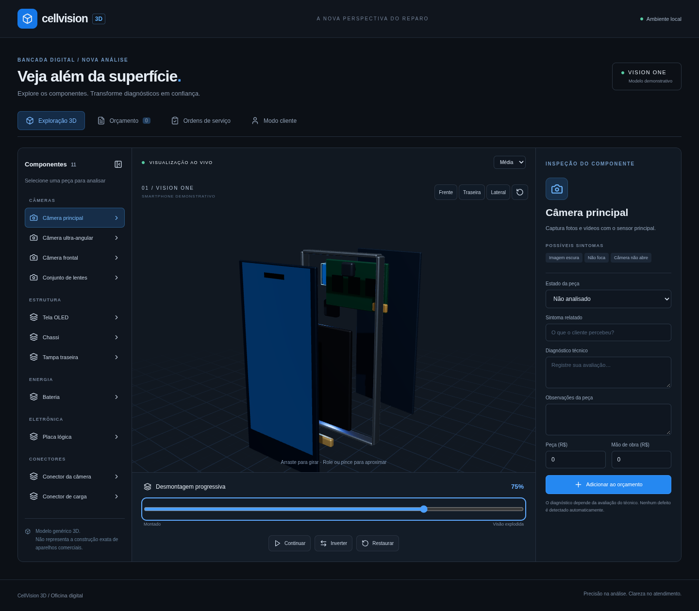
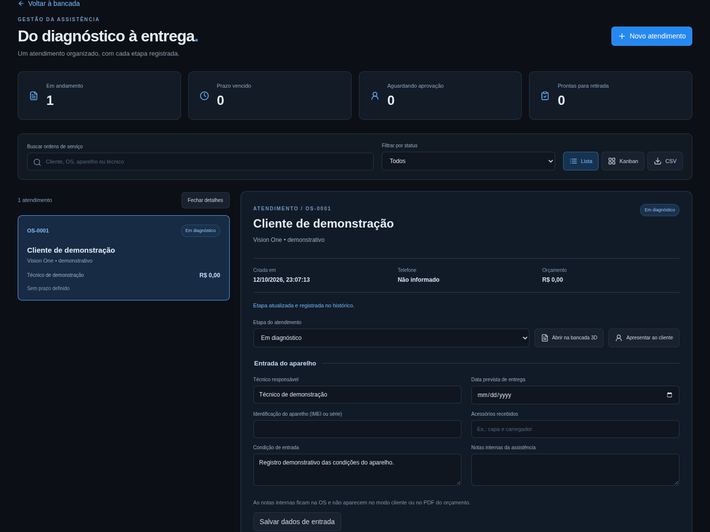

# CellVision 3D

Aplicação web em português brasileiro para assistências técnicas de celulares: explore um smartphone em 3D, registre diagnósticos, prepare orçamentos visuais e acompanhe ordens de serviço.

**Versão atual:** aplicação local-first com API própria e persistência durável. O aparelho 3D é demonstrativo e não representa a construção exata de um modelo comercial.

## Veja o projeto

### Bancada 3D



### Ordens de serviço



Capturas reais da aplicação. O atendimento exibido usa dados fictícios de demonstração.

## Funcionalidades

- **Visualizador 3D:** rotação, zoom, vistas frontal/traseira/lateral, restauração da câmera e seleção de peças por clique ou lista.
- **Desmontagem progressiva:** controle de 0% a 100%, pausa, inversão e restauração, com transformações próprias de cada peça.
- **Diagnóstico:** sintomas, avaliação técnica, estado da peça, observações e valores de peça e mão de obra. Defeitos são registrados pelo técnico.
- **Orçamentos:** várias peças, desconto, cálculo em centavos, salvamento local, exportação PDF, impressão e mensagem preparada para WhatsApp.
- **Modo cliente:** apresentação simplificada do diagnóstico, orçamento e prazo no mesmo dispositivo.
- **Ordens de serviço:** cópias do orçamento e diagnóstico por atendimento, técnico responsável, prazo, condição de entrada e acessórios recebidos.
- **Acompanhamento:** checklists antes/depois, histórico de alterações, registro manual de aprovação, busca, filtros, lista, Kanban e exportação CSV.
- **Responsividade:** fluxos verificados nas larguras de 360, 390, 768 e 1440 px.
- **Desempenho:** carregamento separado do visualizador e PDF, limite de pixel ratio, níveis de qualidade e fallback de WebGL.

Alterações no orçamento de uma OS invalidam a aprovação anterior. Avançar para reparo exige aprovação registrada; marcar uma OS como pronta ou entregue exige checklist pós-reparo concluído e sem falhas.

## Executar localmente

Requer **Node.js 22.12+** e npm. Ambiente validado com Node.js 24.19.

```sh
git clone https://github.com/aleff26042110/ASSISTRNCIA-TECNICA-celular-.git
cd ASSISTRNCIA-TECNICA-celular-
npm ci
npm run build
npm run server
```

Depois do build, `npm run server` serve o site e a API em `http://127.0.0.1:8787`. Os dados ficam em `data/cellvision.json`; a gravação é atômica para evitar arquivos parcialmente escritos. Use `PORT` e `DATA_FILE` para personalizar porta e banco. O servidor escuta somente a máquina local por padrão; defina `HOST=0.0.0.0` conscientemente se precisar expô-lo na rede.

Para desenvolver, execute a API e o Vite em dois terminais:

```sh
npm run server
npm run dev
```

O Vite usa a porta 5173 e encaminha `/api` para a API local. Se a API estiver indisponível, o site continua trabalhando no armazenamento do navegador e informa que há alterações ainda não sincronizadas.

Para gerar a versão de produção:

```sh
npm run build
```

O resultado fica em `dist/`. Ao hospedar, configure o servidor para retornar `index.html` nas rotas da aplicação, como `/ordens` e `/cliente`.

## Usar a aplicação

1. Na **Exploração 3D**, selecione uma peça e registre o diagnóstico.
2. Informe os valores e clique em **Adicionar ao orçamento**.
3. Em **Orçamento**, preencha o cliente, aparelho, desconto e prazo. Salve ou exporte o PDF.
4. Clique em **Criar ordem de serviço** para guardar esse atendimento e acompanhar o reparo.
5. Na OS, registre dados de entrada, responsável, checklists e resposta do cliente.
6. Use **Abrir na bancada 3D** para revisar o diagnóstico. Após editar, clique em **Atualizar e abrir OS** para salvar a nova versão.
7. Use **Modo cliente** para apresentar o orçamento. O WhatsApp abre a mensagem e depende de confirmação para envio.

## Testes

```sh
npm test
npm run build
npm run test:e2e
```

Os testes de navegador requerem Chromium. Neste ambiente, usam `/usr/bin/chromium`. Em outro sistema:

```sh
npx playwright install chromium
```

Depois, defina `CHROMIUM_PATH` com o caminho do navegador instalado ou gerencie essa variável pelo seu ambiente de desenvolvimento. Para consultar o caminho:

```sh
node -e "console.log(require('@playwright/test').chromium.executablePath())"
```

A suíte contém **13 testes de regras/cálculo** e **16 cenários de navegador**, incluindo rotação, zoom, desmontagem, seleção, orçamento, PDF, persistência, OS, privacidade da apresentação, falhas de armazenamento e responsividade. O workflow do GitHub executa o build e essas suítes em pushes e pull requests.

## Tecnologias

React · Vite · TypeScript · Three.js · React Three Fiber · Drei · Zustand · React Router · Lucide · jsPDF · Vitest · Playwright.

## Estrutura

```text
src/
  Viewer.tsx          Visualizador e componentes 3D
  App.tsx             Bancada, orçamento e modo cliente
  ServiceOrders.tsx   Interface de ordens de serviço
  orders.ts           Regras do atendimento e exportação CSV
  orderStore.ts       Persistência de OS e contrato de serviço
  store.ts            Estado e persistência da bancada
  services.ts         Cálculo, orçamento local e PDF
  data.ts             Catálogo demonstrativo
  types.ts            Interfaces do domínio
  *.test.ts           Testes de regras e cálculos
e2e/                  Testes de navegador
scripts/              Coleta de referências públicas
.github/workflows/    Validação contínua
docs/                 Imagens e referências
```

## Limites e próximos passos

- A API sincroniza dados entre sessões que usam o mesmo servidor e mantém cache local para trabalho offline. Ainda não há autenticação multiusuário nem backup remoto; não exponha o serviço diretamente à internet.
- Notas internas não aparecem na apresentação ao cliente ou no PDF do orçamento. Essa separação de telas não é controle de acesso entre pessoas que usam o mesmo dispositivo.
- Aprovação é um registro manual do técnico, não assinatura digital ou confirmação autenticada do cliente.
- Não há catálogo de aparelhos comerciais, preços reais predefinidos, detecção automática de defeitos ou pagamentos integrados.
- O carregador GLB/glTF e os contratos de persistência estão preparados para expansão. Modelos reais exigem mapeamento de peças e validação técnica.
- Supabase, isolamento por assistência com RLS, estoque, fotografias de entrada/saída e links seguros são evoluções futuras.

## Referências e documentação

As funcionalidades públicas do RepairDesk foram estudadas com REA para orientar o módulo de OS. A análise documenta as fontes, evidências e decisões próprias; a aplicação autenticada do fornecedor não foi observada.

- [Guia de desenvolvimento](DEVELOPMENT.md)
- [Análise do RepairDesk com REA](docs/references/repairdesk/ANALYSIS.md)
- [Resumo das evidências](docs/references/repairdesk/evidence-summary.json)
